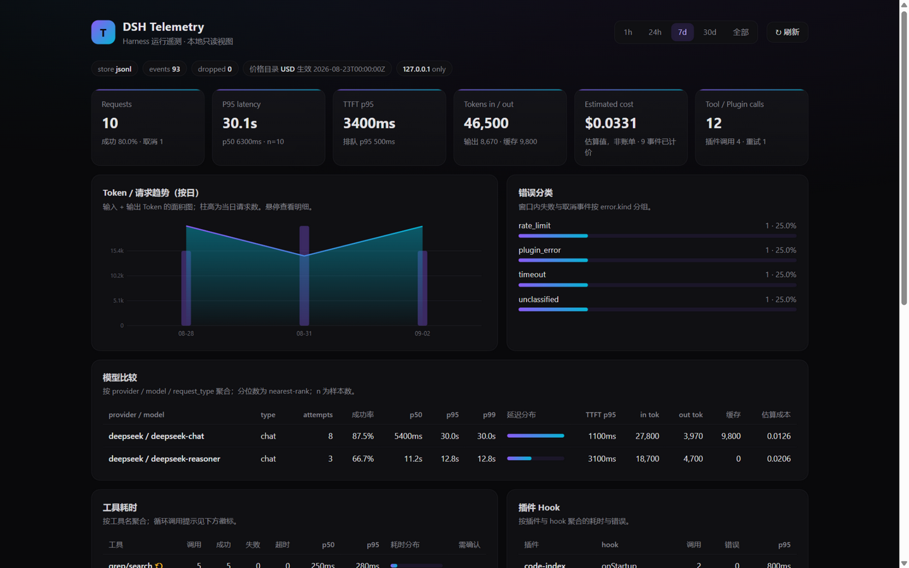
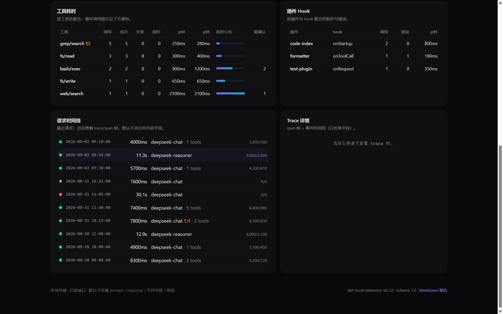
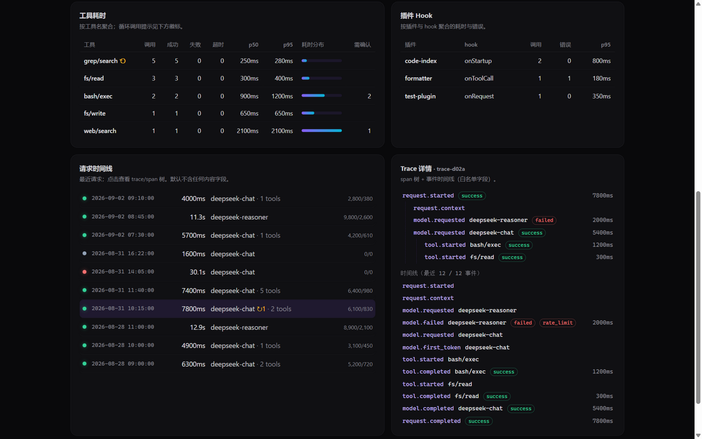

# dsh-telemetry

[English](README.md) | 简体中文

[](LICENSE)
[](https://github.com/topics/dsh-plugin)
[](https://github.com/duyanta123/dsh-telemetry/actions/workflows/ci.yml)
[](https://www.npmjs.com/package/dsh-local-telemetry)
[](CHANGELOG.md)

本地优先的 Harness 运行遥测插件：记录请求、模型、工具与插件生命周期指标（延迟、Token、成本、错误、缓存），默认不采集内容。

> npm 包名为 `dsh-local-telemetry`（`dsh-telemetry` 在 npm 上已被第三方占用）；GitHub 仓库名保持 `dsh-telemetry`，两者指向同一项目。

## 定位

dsh-telemetry 是 Harness 运行可观测性插件，不负责业务分析，不负责修改请求内容，也不负责把用户对话上传到第三方平台。

它回答：
- 一次请求花了多少时间？
- 时间消耗在模型、工具、插件还是排队？
- 输入/输出 Token 和重试成本是多少？
- 哪些工具调用最慢、最容易失败？
- 哪些插件发生异常或阻塞？
- 缓存是否命中，模型路由是否节省了成本？
- 是否存在上下文过大、循环工具调用和异常重试？

一句话定位：

> Make Harness behavior measurable without collecting sensitive conversation content by default.

## 界面预览

**一屏总览**——请求、P95 延迟、首 Token 延迟、Token/缓存命中、估算成本（配置价格目录后自动计算）与错误分类，全部指标标注样本数，可由原始事件重算：



**工具与插件耗时**——循环调用 ⚠ 提示、需用户确认的调用计数、插件 hook 错误统计；下方请求时间线以状态点区分成功/失败/取消，重试请求带 ↻ 标记：



**Trace 详情**——点击任意请求展开 span 树与事件时间线；下图展示 deepseek-reasoner 触发 rate_limit 后回退 deepseek-chat 成功的完整链路（每个 attempt 独立计时）：



> 以上截图为本地只读 Web UI（`--ui`，仅绑定 127.0.0.1），数据为演示数据集；默认配置下不采集 prompt / response / 文件内容 / 密钥。

## 安装

作为 DSH 插件（推荐）：

```bash
dsh plugin --profile web add "github:duyanta123/dsh-telemetry#main"
```

兼容性分层：JSONL 和纯 CLI 能力可独立运行在 Node.js >= 18；SQLite 后端要求 Node.js >= 22.5；作为 DSH 0.1.5-rc.2 插件验证统一使用 Node.js >= 22.19。运行 `npm run test:compat` 可执行隔离 profile 的 add、dump-config 和启动 smoke test。

**最低宿主版本**：会话自动采集针对 DeepSeek Harness `0.1.5-rc.1+` 实测（兼容门禁钉 `0.1.5-rc.2`）。更旧的宿主上插件仍可安装运行——自动降级为显式接入模式（技能 + CLI + 独立 UI），只留一次性提示，其余功能不受影响。

**新机器快速开始（只需要 DSH）**：

```bash
# 1. 在任意 DSH profile 里安装
dsh plugin --profile <name> add "github:duyanta123/dsh-telemetry#main"
# 2. 重启该 profile（如 dsh --profile <name>）——采集自动开始
# 3. 查询或打开仪表盘
node ~/.dsh/profiles/<name>/node_modules/dsh-local-telemetry/bin/telemetry.mjs --status
node ~/.dsh/profiles/<name>/node_modules/dsh-local-telemetry/bin/telemetry.mjs --ui --port 47610
```

或从 npm 安装（作为库或独立 CLI 使用）：

```bash
npm install dsh-local-telemetry
```

安装后重启 `dsh --profile web`，即可通过 `telemetry-runbook` 技能使用查询 CLI：

```bash
node bin/telemetry.mjs --status
node bin/telemetry.mjs --summary --since 24h
node bin/telemetry.mjs --trace <trace_id>
node bin/telemetry.mjs --ui --port 47610
```

## 快速开始

### 1. 宿主自动接入（DeepSeek Harness 0.1.5-rc.1）

DSH profile 加载本插件后，`plugin/index.js` 会订阅 `@deepseek-ai/dsh-session` 公开声明的会话事件总线：`session/created`、`session/event`、`session/flush`、`session/disposed`。该总线是 **post-commit、fire-and-forget** 的，且宿主会包含（contain）观察者异常——因此采集永远不会影响到 agent loop。本插件不注册任何服务，也不改变请求语义。

映射口径（计划 §3.1：一个 DSH turn = 一个 request span）：

| DSH 会话事件 | 记录事件 | 说明 |
| --- | --- | --- |
| `turn/start` | `request.started` | trace = `<session>#t<turn>`，request_id = `turn-<n>` |
| `step/start` | `model.requested` | 一次模型调用 = 一个 attempt span（request 的子 span） |
| `assistant/chunk`（每个 attempt 首条） | `model.first_token` | TTFT 权威口径（append 顺序即时间顺序） |
| `assistant/message` | `model.completed` | token 取自 `usage`；模型归属取自 `message.source` |
| `assistant/attempt`，或无消息的 `step/end` | `model.failed` | `error.kind` = `no_message` / `no_completion` |
| `llm/retry` | `model.failed` + `model.requested` | 重发的 attempt 单独成 span，attempts/重试口径才正确 |
| `tool/call` / `tool/result` | `tool.started` / `tool.completed` | 按 `callId` 配对；`isError` → `result.status = failed` |
| `hook/invoked` / `hook/result` | `plugin.started` / `plugin.completed` | 仅命令 hook（计划 §4.4） |
| `turn/end` | `request.completed` / `request.cancelled` | `reason.kind` 映射为 success / cancelled / failed |

**永不读取**（隐私 §6）：`tool/call.arguments`、`assistant/message.message.content`、`stream.texts`，以及 `request/header` 的 body（内含完整 system prompt）。只记录名称、ID、计数、状态、耗时和 token 总量。

为什么不走 `sessionTelemetry` seam：`dsh-base` 已经挂了 `@deepseek-ai/dsh-session-telemetry-otel`，**重复注册 service 会抛错**；而且那一行是 `mode: FEEDBACK_ONLY` + on-demand capture，只有用户显式 feedback 才采集，无法支撑「本地常开」遥测。`session-telemetry/record` 是同一按需路径上的脱敏 waterfall，不适合当采集通道。

能力声明如实反映实情（`getCapabilities()`）：`lifecycle_hooks: "partial"` —— usage/cache/first-token 为 `confirmed`，插件生命周期为 `partial`（只能观察命令 hook；进程内插件初始化不在总线上），成本始终来自版本化价格目录而非宿主。

在 profile 补丁里配置：

```yaml
- id: dsh-local-telemetry
  name: dsh-local-telemetry
  config:
    telemetry:
      store: sqlite
      path: ~/.dsh/telemetry
      sample_rate: 1
```

非 DSH 宿主、测试与上层插件仍可显式驱动记录器。注意 `createRecorder` 的形参是 `{ config, sink, now }`，插件配置要放在 `config` 下（直接传配置对象会被当成 opts 而静默丢失）：

```js
import { createRecorder } from 'dsh-local-telemetry/telemetry';

const recorder = createRecorder({ config: { path: '~/.dsh/telemetry' } });
await recorder.start();   // 异步：sqlite 后端按需加载
recorder.record({ event: 'model.completed', trace_id: 'trace-001', span_id: 'span-003' });
await recorder.close();   // flush；失败不阻塞退出
```

宿主接入健康状况可随时查询（`apply()` 返回值里也有）：

```js
import { createDshAdapter } from 'dsh-local-telemetry/telemetry';
adapter.snapshot();   // { attached, received, mapped, recorded, ignored, invalid, dropped_sink, errors, sessions, unmapped_types }
```
### 2. 聚合读取（上层插件可引用）

```js
import { openStore, aggregateEvents, buildTraceView } from 'dsh-local-telemetry/telemetry';

const store = await openStore({ store: 'jsonl', path: '~/.dsh/telemetry' });
const { events } = await store.readEvents({ fromMs: Date.now() - 3600e3 });
const summary = aggregateEvents(events, { catalog: null });

console.log(`P95 latency: ${summary.requests.latency.p95}ms, Input tokens: ${summary.tokens.input}`);
```

### 3. 作为 DSH 技能调用（CLI 由技能指引）

```bash
node bin/telemetry.mjs --summary --since 1h --group-by model
node bin/telemetry.mjs --export TELEMETRY-REPORT.md --since 7d --format markdown
node bin/telemetry.mjs --purge --before 30d
node bin/telemetry.mjs --ui --port 47610
```

## CLI 参数

| 参数 | 默认 | 说明 |
| --- | --- | --- |
| `--store jsonl\|sqlite` | jsonl | 存储后端（sqlite 需 Node ≥22.5） |
| `--path <dir>` | ~/.dsh/telemetry | 数据目录 |
| `--config <file>` | - | 配置文件 |
| `--since <duration\|ts>` | - | 时间窗起点（如 1h / 7d / ISO 时间戳） |
| `--until <duration\|ts>` | - | 时间窗终点 |
| `--profile <name>` | - | 按 profile 过滤 |
| `--model <name>` | - | 按模型过滤 |
| `--plugin <name>` | - | 按插件过滤 |
| `--event <name\|prefix.*>` | - | 按事件过滤（如 model.*） |
| `--group-by <key>` | - | 分组：model\|plugin\|tool\|profile\|day。`tool` 分组用 `calls`（组内 tool.completed 数）代替 `requests`——工具调用不是请求，`requests` 恒为 0 |
| `--format text\|json\|markdown` | text | 输出格式（`--export` 未指定时按扩展名 `.json`/`.md` 推断） |
| `--errors-only` | - | 只看错误与取消 |
| `--slow-over-ms <N>` | - | 只看耗时 ≥ N 的请求 |
| `--sample-rate <0..1>` | - | 采样率（录制侧配置） |
| `--capture-metadata none\|safe` | - | metadata 采集（录制侧配置） |
| `--purge --before <d>` | - | 保留期清理 |

## 隐私与安全

- **默认不采集内容**：prompt、response、文件内容、命令参数、环境变量和密钥。
- **脱敏策略**：敏感字段（Authorization、Cookie、token、password、api_key 等）整键丢弃；URL 凭据与 query token 脱敏；绝对路径可配置为 basename 或哈希。
- **名称哈希**：工具、插件、模型名与 profile 可配置哈希化，稳定但不可直接还原。
- **本地存储**：默认 `~/.dsh/telemetry`（JSONL 按日期分文件，SQLite 可选），不联网。
- **只读 UI**：`--ui` 只绑定 127.0.0.1，禁止默认暴露到局域网。

## 排障

**`--store sqlite` 启动报错？**
SQLite 后端依赖 Node.js 内置的 `node:sqlite`，要求 Node >= 22.5；用 `node --version` 确认版本，或改用默认 JSONL 后端（Node >= 18 即可）。

**Web UI 打不开，或端口被占用？**
`--ui` 只绑定 `127.0.0.1`（安全设计，不暴露局域网），远程机器请通过 SSH 隧道访问；默认端口 47610 被占用时用 `--port` 更换。

**摘要里成本显示为 null？**
成本 = Token 用量 × 价格目录。未提供价格目录（`--config` 或数据目录下的 `prices.json`）时成本按缺失记录（null 而非 0），配置后可对历史事件重算；字段语义见 [docs/schema.md](docs/schema.md)。

**`--status` 显示采集未生效？**
配置文件解析失败时记录器按 fail-open 原则降级为 disabled（安全默认），请检查配置文件语法与字段名；JSONL 事件按日期分文件写入 `~/.dsh/telemetry`，确认该目录有当日文件。

**升级 DSH 宿主到 0.1.5 系后旧会话打不开？**
Session format V3 迁移不可逆，属宿主行为；升级宿主前请先备份会话日志（见 [CHANGELOG.md](CHANGELOG.md) 0.1.2 条目）。

## 文档

- [docs/configuration.md](docs/configuration.md) — 配置文件、字段表、脱敏规则、资源预算、价格目录格式
- [docs/schema.md](docs/schema.md) — 事件契约 schema version 1.0、12 种事件与字段约束
- [examples/telemetry.json](examples/telemetry.json) / [examples/prices.json](examples/prices.json) — 配置样例
- [CHANGELOG.md](CHANGELOG.md) — 版本变更记录
- [DSH-TELEMETRY-开发计划.md](DSH-TELEMETRY-开发计划.md) — 设计与迭代历史

## 版本与路线

- **v0.1.0（已发布）**：本地 JSONL + 可选 SQLite（Node ≥22.5 内置 `node:sqlite`）、request/model/tool/plugin 基础事件、启停配置、fail-open、`--status`/`--summary`/`--trace`/`--export`/`--purge`/`--ui`、默认不采集内容、采样与保留策略、成本目录与脱敏、Markdown 报告、Trace/span 树与时间线视图。
- **v0.1.1 / v0.1.2（已发布）**：`npm run test:compat` 兼容门禁与三层兼容性说明；DSH 宿主基线迁移至 `0.1.5-rc.2`（插件代码零改动）。
- **v0.2.0**：宿主自动接入——订阅 DSH session 事件总线，按会话（携带 `session.id`）把真实流量映射为 request/attempt/tool/hook 事件；重试口径修正为「失败后重发才算重试」；sqlite 不可用自动回退 jsonl 并如实报告生效后端；sink 未就绪不再静默丢数据。
- 后续迭代以 [DSH-TELEMETRY-开发计划.md](DSH-TELEMETRY-开发计划.md) 为准。

## 许可证

MIT
